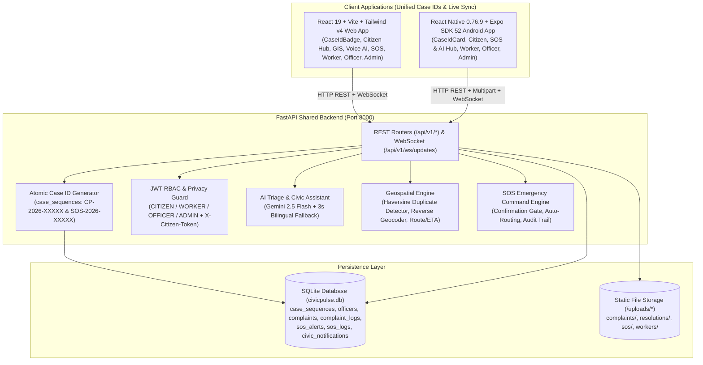

# CIVICPULSE AI — SYSTEM ARCHITECTURE

**Project:** CivicPulse AI  
**Team:** Alronclad — KSR Institute of Engineering and Technology (KSRIET)  

---

## 1. High-Level Multi-Tier Architecture

---

## 2. Database Schema (`backend/models.py`)

1. **`case_sequences`**:
   - Stores atomic per-year counters (`prefix` `'CP'` or `'SOS'`, `year` e.g. `2026`, `current_val` e.g. `93`) ensuring collision-free sequential Case IDs (`CP-2026-00001` .. `CP-2026-00093`, `SOS-2026-00001`).
2. **`officers`**:
   - Stores `ADMIN`, `OFFICER`, and `WORKER` accounts (`id`, `name`, `email`, `password_hash`, `department`, `role`, `is_active`, `created_at`).
3. **`complaints`**:
   - Stores citizen grievances (`id`, `case_id` (`CP-2026-XXXXX`, unique indexed), `tracking_id` (unique indexed), `idempotency_key` (unique indexed), `is_private`, `citizen_token`, `citizen_text`, `voice_transcript`, `category`, `priority`, `department`, `status`, `latitude`, `longitude`, `address_text`, `photo_url`, `duplicate_group_id`, `duplicate_confidence`, `ai_source`, `assigned_officer_id`, `assigned_worker_id`, `worker_before_photo_url`, `worker_after_photo_url`, `worker_completion_note`, `resolution_photo_url`, `resolution_note`, `created_at`, `updated_at`).
4. **`complaint_logs`**:
   - Immutable audit trail for complaint creation, duplicate merging, officer assignment, worker dispatch, status updates, and resolution proof verification.
5. **`sos_alerts`**:
   - Stores emergency SOS dispatches (`id`, `case_id` (`SOS-2026-XXXXX`, unique indexed), `tracking_id`, `emergency_type`, `description`, `latitude`, `longitude`, `address_text`, `citizen_name`, `citizen_phone`, `trusted_contacts_json`, `photo_url`, `priority`, `status`, `assigned_officer_id`, `assigned_officer_name`, `resolution_note`, `created_at`, `updated_at`).
6. **`sos_logs`**:
   - Immutable audit trail for SOS emergency transitions (`SUBMITTED` $\rightarrow$ `ACKNOWLEDGED` $\rightarrow$ `RESPONDING` $\rightarrow$ `RESOLVED` / `CANCELLED`).
7. **`civic_notifications`**:
   - Role-targeted (`CITIZEN`, `WORKER`, `OFFICER`, `ADMIN`, `ALL_STAFF`) real-time notification records containing `case_id` / `tracking_id`.
